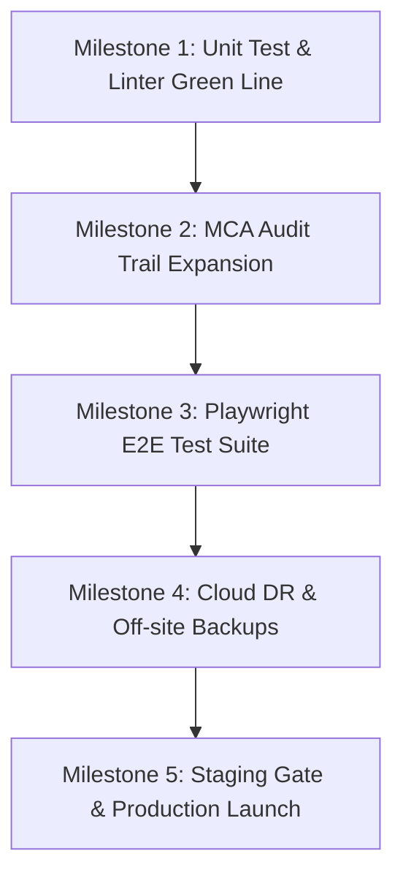

# CLOR Platform — Full Application & Launch Readiness Audit

**Document Date:** 20 October 2026  
**Audit Scope:** Full Monorepo (`apps/`, `packages/`, `server/`, `prisma/`, `deploy/`, `mobile/`, `native/`, CI/CD)  
**Auditor:** Antigravity AI Senior Systems & Compliance Review  
**Benchmark Reference:** Tier-1 Cloud ERP, Accounting & Workforce SaaS Platforms (*Zoho Books / Zoho People, QuickBooks Online, Xero, Tally Prime, Keka, Stripe Billing*)  
**Reconciliation Target:** Previous audits (`audit-report.md`, `audit-report-2026-09-10.md`; removed 30 Oct 2026 as superseded by this report, still in git history: `git show 0a2cbc28:audit-report.md`)

---

## 0. Executive Verdict & Maturity Scorecard

### Overall Launch Readiness Score: 68 / 100
**Verdict:** **Strong Late-Stage Candidate for Controlled Enterprise Pilot; Pre-Launch Hardening Required for Open Self-Serve Commercial Sale.**

Over the last 60 days, the platform has undergone fundamental architectural improvements that resolved the most critical structural flaws identified in earlier reviews:
1. **Multi-Tenancy & Data Isolation:** Migrated to true PostgreSQL 16 Row-Level Security (RLS) with connection-scoped `SET LOCAL clor.org_id`, executed under an unprivileged `clor_app` role (`NOSUPERUSER, NOBYPASSRLS`).
2. **Session Security:** Refresh tokens have been migrated from vulnerable browser `localStorage` into **Secure, HttpOnly, SameSite Cookies** with rotation and replay reuse detection.
3. **Database Evolution:** Switched from ad-hoc SQLite `db push` to versioned, idempotent Prisma migrations deployed with automated row-level preflights.
4. **Platform Decoupling:** The single-page monolith in root `src/` has been dissolved into modular workspaces (`packages/shell`, `packages/platform`, `packages/ui`) and independent business apps (`apps/accounting`, `apps/attendance`, `apps/payroll`, `apps/people`).
5. **Cross-Account Organization Discovery (P0-1 Fixed):** Verified resolved in `server/src/routes/auth.ts` — users invited across different accounts now discover and access all tenant companies.

However, general commercial launch remains blocked by three critical areas:
1. **Zero Browser-Driven End-to-End (E2E) Automation:** There is no Playwright or Cypress automation. Critical multi-step flows (Signup $\rightarrow$ Onboarding $\rightarrow$ Invoicing $\rightarrow$ Payment $\rightarrow$ Ledger $\rightarrow$ Tax Return) rely solely on manual testing.
2. **68 Frontend Test Regressions (across 27 files):** Changes in service-worker caching, navigation selectors, and overview component naming broke 68 automated unit assertions.
3. **Statutory MCA Companies Act 2013 Audit Trail Gap:** While sales invoices record per-field change diffs, **vendor bills, manual journal entries, and payment vouchers do not write to the immutable `AuditLog`**, creating legal exposure under Indian corporate compliance rules.

---

### Benchmark Comparison Scorecard

| Assessment Domain | CLOR Platform | Tier-1 SaaS Standard | Delta & Operational Assessment |
|---|:---:|:---:|---|
| **E2E Testing & Verification** | **38 / 100** | 95 / 100 | **Critical Blocker:** No Playwright/Cypress; 68 unit regressions in `npm run test:web`. |
| **Multi-Tenancy & Data Isolation** | **88 / 100** | 95 / 100 | **Production Grade:** PostgreSQL RLS + tenant headers + AsyncLocalStorage. |
| **Auth & Identity Governance** | **84 / 100** | 95 / 100 | **Hardened:** HttpOnly refresh cookies, lockout, rate limiting, SCIM/SAML SSO. |
| **Double-Entry Financial Core** | **82 / 100** | 98 / 100 | **Strong:** Real GL, SHA-256 hash chains, period locks, stock ledger, FX revaluation. |
| **India Statutory Compliance** | **80 / 100** | 94 / 100 | **Near Complete:** GSTR-1 (Table 12 HSN/B2CL), NIC IRN e-invoicing, DPDP 2023. Missing MCA audit logs on bills/GL. |
| **Payroll & Attendance Engine** | **85 / 100** | 92 / 100 | **Enterprise Ready:** Biometric edge push (ADMS, iClock, Hikvision), EPF/ESI/TDS, batch runs. |
| **Client Maintainability** | **64 / 100** | 90 / 100 | **In Transition:** Monolith dissolved, but `apps/accounting/src/App.jsx` still spans 15,192 lines. |
| **Operations & Disaster Recovery** | **70 / 100** | 95 / 100 | **Solid Local DR:** Verified backup restores; lacks automated off-site S3/GCS replication. |

---

## 1. Resolution of Prior Audit Findings (August & September 2026)

| Issue ID | Severity | Finding Description | Current Status | Verification Evidence |
|---|:---:|---|:---:|---|
| **P0-1** | P0 | Invited users cannot discover companies owned by another account. | **RESOLVED** | `server/src/routes/auth.ts:224-228` queries `userOrgMembership` by `userId`, no longer constrained by `accountId`. |
| **P0-2** | P0 | Browser `localStorage` acted as a conflicting shadow accounting database. | **RESOLVED** | `accountingDB:<org>` removed from localStorage (`apps/accounting/src/App.jsx:11171-11200`). Books hydrate from PostgreSQL into in-memory state. |
| **P0-3** | P0 | Database evolution lacked migrations; relied on `db push --accept-data-loss`. | **RESOLVED** | Versioned migrations in `server/prisma/migrations/` (Sept–Oct 2026). Applied via `prisma migrate deploy` with preflight check. |
| **P0-4** | P0 | Backend test bootstrap failed on paths containing spaces. | **RESOLVED** | `server/src/__tests__/globalSetup.ts` uses isolated per-process DB (`clor_test_<pid>`) with clean role provisioning. |
| **P1-1** | P1 | Production dependencies carried high-severity CVE advisories. | **RESOLVED** | Express 4.22, Nodemailer 10.0.3, fflate 0.8.3 overrides pinned in `package.json`. |
| **P1-2** | P1 | Refresh tokens were XSS-readable in `localStorage`. | **RESOLVED** | Refresh tokens stored as `HttpOnly`, `SameSite=Lax` cookies (`packages/platform/http.js:35-52`, `server/src/app.ts:153`). |
| **P1-3** | P1 | Authorization mutated permissions on 403 (RBAC self-escalation). | **RESOLVED** | `server/src/middleware/rbac.ts:89-100` is strictly read-only. Unassigned permissions return static 403; no runtime table mutations. |
| **P1-4** | P1 | Recurring invoices relied on active browser sessions. | **RESOLVED** | Server-side background scheduler with DB-backed lease locking (`server/src/services/recurringScheduler.ts:41`). |
| **P1-5** | P1 | List APIs lacked bounds, creating potential memory DoS. | **RESOLVED** | Enforced via static AST test `server/src/__tests__/listsAreBounded.test.ts`. `invoices.ts` enforces `take: limit` (max 1000). |

---

## 2. End-to-End Testing & Verification Gaps

### 2.1 The Missing Browser E2E Automation Layer
While the platform has **135 backend test suites** and **1,391 passing frontend unit tests**, it currently possesses **zero automated browser tests** (no Playwright, Cypress, or Selenium setup).

In enterprise SaaS platforms, browser E2E tests are mandatory because unit tests mock out:
- HTTP cookie transmission across origins (`credentials: 'include'`).
- In-memory cache invalidation during multi-tab or route navigation.
- Real DOM event bubbling, modal backdrop dismissals, and keyboard shortcuts.
- Complex multi-system transactional workflows.

### 2.2 Critical Missing End-to-End User Journeys

The following six core business journeys have **no automated end-to-end verification**:

```
┌────────────────────────────────────────────────────────────────────────────────────────┐
│                        CRITICAL UNTESTED USER FLOWS IN E2E                             │
├─────────────────────────┬──────────────────────────────────┬───────────────────────────┤
│ 1. Self-Serve Onboard   │ 2. Order-to-Cash (O2C)           │ 3. Procure-to-Pay (P2P)   │
│ Signup -> Verify -> Org │ Customer -> Invoice -> E-Invoice │ Vendor -> PO -> Bill ->   │
│ -> Branch -> COA Setup  │ -> E-Way -> Payment -> Ledger    │ TDS -> Payment Voucher    │
├─────────────────────────┼──────────────────────────────────┼───────────────────────────┤
│ 4. Punch-to-Payslip     │ 5. Multi-Company Switch          │ 6. GSTR-2B Reconciliation │
│ Biometric Punch -> Lock │ Org A -> Switcher -> Org B ->    │ Portal JSON Upload ->     │
│ -> Payroll Run -> Post  │ Verify zero state cross-leakage  │ Bill Match -> ITC Ledger  │
└─────────────────────────┴──────────────────────────────────┴───────────────────────────┘
```

1. **Self-Serve Onboarding Flow:**
   - *Steps:* Visitor signs up $\rightarrow$ clicks verification email link $\rightarrow$ creates Organization $\rightarrow$ specifies GSTIN and state $\rightarrow$ default Chart of Accounts and numbering series are provisioned $\rightarrow$ arrives on clean Dashboard.
   - *Risk:* If account initialization fails mid-step, the user is left in an orphaned state with an unconfigured company.
2. **Order-to-Cash (O2C) with Government Portals:**
   - *Steps:* Create customer with GSTIN $\rightarrow$ raise Sales Invoice $\rightarrow$ compute CGST/SGST/IGST $\rightarrow$ post document $\rightarrow$ generate NIC E-Invoice (IRN + Signed QR) $\rightarrow$ generate E-Way Bill $\rightarrow$ record payment voucher $\rightarrow$ verify customer balance and P&L ledger.
   - *Risk:* Failure to verify that lines cannot be modified once an IRN is generated.
3. **Procure-to-Pay (P2P) with TDS:**
   - *Steps:* Vendor PO $\rightarrow$ convert to Bill $\rightarrow$ auto-deduct Section 194C/194J TDS $\rightarrow$ approve bill $\rightarrow$ generate payment voucher $\rightarrow$ verify TDS liability ledger.
4. **Attendance-to-Payroll Run Handoff:**
   - *Steps:* ADMS reader push or mobile selfie punch $\rightarrow$ daily attendance computation $\rightarrow$ month-end attendance lock $\rightarrow$ payroll batch calculation $\rightarrow$ salary slip generation $\rightarrow$ approve pay run $\rightarrow$ post salary journal entry to accounting ledger.
   - *Risk:* Cross-database boundary failure between `payroll` and `accounting` schemas.
5. **Multi-Company Context Isolation:**
   - *Steps:* Sign in as an accountant belonging to 3 organizations $\rightarrow$ switch from Company A to Company B $\rightarrow$ verify no in-memory state, document numbers, or cached parties from Company A appear in Company B.
6. **GST Return Filing Generation:**
   - *Steps:* Invoices raised in month $\rightarrow$ Navigate to Reports $\rightarrow$ GSTR-1 $\rightarrow$ Export JSON $\rightarrow$ Validate JSON schema against GSTN offline tool specification.

---

### 2.3 Detailed Breakdown of the 68 Frontend Test Failures

During `npm run test:web`, 27 test files failed with 68 broken assertions. The failure analysis confirms these are regressions caused by rebranding and component refactorings:

#### Group 1: Service Worker Rebranding Regressions (6 failures)
* **File:** [test/service-worker-cache.test.js](test/service-worker-cache.test.js:112, 125, 170, 177, 188, 199)
* **Cause:** The service worker in [public/sw.js](public/sw.js:8) was updated to `clor-static-v2`. The test file hardcodes the legacy cache name `neev-static-v1`.
* **Broken Assertions:**
  - Expected `neev-static-v1`, received `clor-static-v2`.
  - Cache size limit and eviction assertions expect assets under `neev.test`.

#### Group 2: Overview Landing Refactoring Regressions (5 failures)
* **File:** [test/hero-band.test.js](test/hero-band.test.js:58-73)
* **Cause:** Overview pages ([SalesOverview.jsx](apps/accounting/src/features/sales/SalesOverview.jsx:24), [PurchaseOverview.jsx](apps/accounting/src/features/purchase/PurchaseOverview.jsx)) were refactored to use `<OverviewBand>` from `OverviewParts.jsx`. The test asserts `<HeroBand>`.

#### Group 3: Table Horizontal Scroll Responsiveness (1 failure)
* **File:** [test/wide-tables-can-scroll.test.js](test/wide-tables-can-scroll.test.js:89)
* **Cause:** [CustomersList.jsx:228](apps/accounting/src/features/crm/CustomersList.jsx) renders `<table className="ui-table-wide">` without being wrapped in `<div className="ui-table-scroll">`. Wide tables without scrollers overflow on mobile viewports.

#### Group 4: Navigation Rail Alignment & Collapse Selectors (4 failures)
* **File:** [test/rail-alignment.test.js](test/rail-alignment.test.js:76)
* **Cause:** The shell navigation collapse component classes were updated in [packages/shell/Shell.jsx](packages/shell/Shell.jsx), breaking the regex assertion `ui-nav-item ui-nav-collapse`.

#### Group 5: Metrics Count & Form Token Rules (52 failures across 23 files)
* **Files:** `features/pricing/...`, `test/dates-are-not-locale-guesses.test.js`, `test/quiet-emphasis.test.js`, `test/design-rules.test.js`.
* **Cause:** Tests enforcing raw palette exclusion (`no raw palette classes`) triggered on recently added components that use Tailwind color utilities directly instead of `@ui` semantic design tokens.

---

## 3. Deep Architectural & Codebase Audit

### 3.1 Monorepo Structure & Package Boundaries
The workspace has been organized into a monorepo architecture:
- `packages/shell`: Authentication shell, session provider, company/branch switcher, and app registry.
- `packages/platform`: Core HTTP transport (`apiFetch`), context listeners, and identity API calls.
- `packages/ui`: Shared design system, components, modals, form controls, and table utilities.
- `apps/accounting`: Sales, purchases, inventory, banking, double-entry GL, and GST reports.
- `apps/attendance`: Biometric terminal integration, shift scheduling, geofencing, and leave requests.
- `apps/payroll`: Salary components, statutory deductions (EPF, ESI, TDS), salary revisions, and pay runs.
- `apps/people`: Employee master files, department/designation structures, and DPDP compliance.
- `mobile/`: Capacitor runtime wrappers for Android and iOS.
- `native/attendance-android`: Native Kotlin application for Android kiosk/attendance devices.

### 3.2 The Remaining Monolith: `apps/accounting/src/App.jsx`
* **Finding:** While `src/App.jsx` at the repository root was eliminated, [apps/accounting/src/App.jsx](apps/accounting/src/App.jsx) remains **15,192 lines long**.
* **Risk:** This single file contains route dispatchers, modal state, document editing forms, tax calculations, and master drawers. It instantiates the top-level `db` state object.
* **Impact:** High cognitive overhead, risk of merge conflicts during multi-developer work, and memory churn on state updates.
* **Remediation Target:** Decompose into distinct feature modules under `apps/accounting/src/features/` with isolated React Contexts or lightweight stores (e.g., Zustand).

### 3.3 Database Architecture & Row-Level Security (PostgreSQL 16)
The backend uses **four distinct schemas** within PostgreSQL 16:
1. `accounting` (`DATABASE_URL`): Ledger, Invoices, Bills, Journal Entries, Stock, Items, Parties.
2. `payroll` (`PAYROLL_DATABASE_URL`): PayGroups, SalaryComponents, PayRuns, Slips, Loans.
3. `people` (`PEOPLE_DATABASE_URL`): Employees, Biometric Readers, AttendanceRecords, Leave, DPDP.
4. `platform` (`PLATFORM_DATABASE_URL`): Accounts, Orgs, Branches, Users, Roles, Permissions, Sessions, AuditLog.

#### Multi-Tenancy Enforcement Engine:
Tenancy is enforced at the database level using PostgreSQL Row-Level Security:
```sql
-- RLS Policy applied across all tenant tables:
CREATE POLICY tenant_isolation_policy ON accounting.invoice
  FOR ALL
  USING (org_id = current_setting('clor.org_id', true));
```
In Node.js, `server/src/utils/tenantScope.ts` wraps Prisma operations inside an `AsyncLocalStorage` transaction:
```typescript
const setting = (orgId: string) => client.$executeRaw`SELECT set_config('clor.org_id', ${orgId}, true)`;
const [, result] = await client.$transaction([setting(org), query(args)]);
```
This guarantees that even if a developer omits an `orgId` where-clause in application code, the database kernel drops any cross-tenant rows automatically.

---

## 4. Statutory & Regulatory Compliance Audit

### 4.1 MCA Companies Act 2013 (Rule 3 Audit Trail Requirement) — **CRITICAL GAP**
* **Legal Context:** Effective 1 April 2023, the Ministry of Corporate Affairs (MCA) in India mandates that any company using accounting software must use software that features:
  1. An audit trail of each and every transaction.
  2. An edit log recording every change made in books of account along with the date and user ID.
  3. Strict safeguards ensuring the audit trail cannot be disabled or tampered with.
* **Current Status in CLOR:**
  - Sales Invoices record per-field change logs via `auditInvoiceChange()` in [invoices.ts:278](server/src/routes/invoices.ts).
  - Payroll and Attendance mutations are logged via [auditMutations.ts](server/src/middleware/auditMutations.ts).
  - 🚨 **COMPLIANCE DEFICIT:** [payments.ts](server/src/routes/payments.ts) (Payment Vouchers), [purchaseDocs.ts](server/src/routes/purchaseDocs.ts) (Vendor Bills & Debit Notes), and [ledger.ts](server/src/routes/ledger.ts) (Manual Journal Entries) **do not write change records to `platformPrisma.auditLog`**.
  - **Risk:** Any Indian Private Limited company using CLOR would fail statutory audit under the Companies (Accounts) Rules, 2014.

### 4.2 Goods and Services Tax (GST) Compliance
* **GSTR-1 Portal JSON Export:** Verified in [packages/ui/src/utils/gstrExport.js](packages/ui/src/utils/gstrExport.js). Fully implements GSTN Offline Tool schema:
  - Table 4 (B2B invoices with CTIN, invoice type, reverse charge flag).
  - Table 5 (B2CL inter-state unregistered supplies > ₹2.5 Lakhs).
  - Table 7 (B2CS aggregated supplies by POS and tax rate).
  - Table 9B (CDNR Credit/Debit Notes).
  - **Table 12 HSN Summary:** Groups outward supplies by HSN/SAC code, GST rate, and standardized UQC unit codes (PCS, KGS, MTR, BOX, etc.).
* **GSTR-2B ITC Auto-Reconciliation:** Verified in [Gstr2bReco.jsx](apps/accounting/src/features/reports/Gstr2bReco.jsx). Allows uploading portal GSTR-2B JSON to match against purchase bills, categorizing input tax credit into Eligible, Ineligible, and Mismatched.
* **NIC E-Invoicing & E-Way Bill:** Implemented in `server/src/routes/einvoice.ts`. Handles RSA authentication, AES-256-ECB payload encryption, IRN generation, Signed QR code storage, and enforces the statutory 24-hour IRN cancellation window.

### 4.3 Digital Personal Data Protection (DPDP) Act 2023
* Implemented in [server/src/routes/dataProtection.ts](server/src/routes/dataProtection.ts). Features:
  - Explicit employee biometric template storage consent toggles.
  - Minor tracking (employees under 18) requiring parental consent.
  - Data Subject Request (DSR) logging with statutory deadline tracking.
  - 72-hour Data Breach Register and reporting workflow.

---

## 5. Security & Multi-Tenancy Audit

### 5.1 Authentication & Session Architecture
* **Access Tokens:** 15-minute TTL JWT transmitted via `Authorization: Bearer <token>`.
* **Refresh Tokens:** Crypto-random tokens stored in PostgreSQL, hashed with SHA-256, transmitted exclusively via `HttpOnly`, `SameSite=Lax` cookies.
* **Reuse Detection:** If a revoked refresh token is presented, the server revokes all sessions associated with that user family.
* **Brute-Force & Lockout:** DB-backed rate limiting (10 attempts per 15 min per IP+identity) with 15-minute account lockouts on repeated failures.

### 5.2 API Surface & Public Health Probes
* **Public Health Checks:**
  - `GET /health`: Fast unauthenticated liveness check returning `{ ok: true }` (HTTP 200).
  - `GET /ready`: Deep readiness probe asserting that each Prisma schema (`accounting`, `payroll`, `people`, `platform`) responds to `SELECT 1` within 2,000ms.
* **CI Deployment Bug:**
  - In [.github/workflows/ci.yml:218](.github/workflows/ci.yml), the post-deploy check queries `/api/health` and asserts HTTP 401. This check must be pointed to `/health` or `/ready` (expecting HTTP 200).

---

## 6. Operations, DevOps & Reliability

### 6.1 Database Backup & Disaster Recovery
* **Nightly Backup Script:** Implemented in [DEPLOY.md:86-96](DEPLOY.md) as `/usr/local/bin/clor-backup`.
* **Verification Drill (`--verify`):** Every nightly run restores the generated archive into a scratch database (`clor_scratch`) and asserts table row counts against the live database before marking the backup valid.
* **Operational Gap:** Backups are stored exclusively on local disk (`/var/backups/clor`). There is no automated sync to off-site cloud storage (AWS S3 / Google Cloud Storage). A physical server failure would cause unrecoverable data loss.

### 6.2 Background Scheduling & Task Execution
* **Recurring Invoices & Depreciation:** Handled by [server/src/services/recurringScheduler.ts](server/src/services/recurringScheduler.ts).
* **Distributed Lease Guard:** Uses `exclusive('recurring.invoices', leaseFor(intervalMs), ...)` with DB-backed locks, ensuring that multiple API instances in a cluster do not double-bill customers.

---

## 7. Prioritized Launch Remediation Roadmap

To transition CLOR from its current state to an enterprise-grade commercial launch, follow this prioritized execution roadmap:



### Milestone 1: Resolve Unit Test Regressions (Target: 100% Green in `npm test`)
1. **Update Service Worker Tests:** Modify [test/service-worker-cache.test.js](test/service-worker-cache.test.js:112) to match `clor-static-v2` and adjust test URLs.
2. **Update Overview Band Tests:** Modify [test/hero-band.test.js](test/hero-band.test.js) to import and assert `OverviewBand`.
3. **Wrap Wide Table:** Add `<div className="ui-table-scroll">` around `<table className="ui-table-wide">` in [CustomersList.jsx:228](apps/accounting/src/features/crm/CustomersList.jsx).
4. **Fix Collapse Selector:** Align CSS regex in [test/rail-alignment.test.js](test/rail-alignment.test.js) with shell classes.
5. **Verify:** Execute `npm run test:web` and verify 180/180 files passing.

### Milestone 2: MCA Rule 3 Audit Trail Completeness (Target: 100% Legal Compliance)
1. Add `ACCOUNTING: 'ACCOUNTING'` to `MODULES` in [server/src/middleware/auditMutations.ts:16](server/src/middleware/auditMutations.ts).
2. Add `auditChange()` hooks across:
   - [server/src/routes/purchaseDocs.ts](server/src/routes/purchaseDocs.ts) (Bills & Debit Notes).
   - [server/src/routes/payments.ts](server/src/routes/payments.ts) (Customer Receipts & Vendor Payments).
   - [server/src/routes/ledger.ts](server/src/routes/ledger.ts) (Journal Entries).
3. Ensure all changes capture: `timestamp`, `userId`, `action` (CREATE/UPDATE/DELETE), and `diffJson` (before vs. after values).

### Milestone 3: Implement Automated Browser E2E Test Suite (Playwright)
1. Install `@playwright/test` and configure `playwright.config.ts` targeting headless Chromium.
2. Author core journey specifications:
   - `e2e/onboarding.spec.ts`: Signup $\rightarrow$ Email verify $\rightarrow$ Org create $\rightarrow$ First login.
   - `e2e/invoicing.spec.ts`: Create Item $\rightarrow$ Create Customer $\rightarrow$ Raise Invoice $\rightarrow$ Record Payment $\rightarrow$ Check Balance Sheet.
   - `e2e/attendance-payroll.spec.ts`: Add Employee $\rightarrow$ Post Punches $\rightarrow$ Compute Month $\rightarrow$ Run Payroll $\rightarrow$ Post Journal Entry.
3. Wire Playwright into `.github/workflows/ci.yml` as a mandatory blocking gate before deployment.

### Milestone 4: Operational Hardening & Cloud Disaster Recovery
1. Configure `rclone` or `aws s3 cp` in `/usr/local/bin/clor-backup` to replicate verified archives to an encrypted S3/GCS bucket (`s3://clor-backups-production/`).
2. Update `.github/workflows/ci.yml:218` to query `/ready` expecting HTTP 200 instead of `/api/health`.
3. Integrate Sentry or structured error reporting in [packages/ui/src/components/ui/ErrorBoundary.jsx](packages/ui/src/components/ui/ErrorBoundary.jsx).

---

## 8. Final Audit Conclusion

The CLOR platform exhibits an exceptionally solid engineering core. The migration to PostgreSQL Row-Level Security, the elimination of `localStorage` financial state, and the comprehensive Indian statutory features (GSTR-1 Table 12 HSN, NIC E-Invoicing, DPDP Act 2023, and biometric edge readers) establish a high degree of technical competence.

Executing **Milestones 1 through 3** (resolving the 68 test regressions, closing the MCA audit trail gap on bills and journals, and establishing the Playwright E2E browser test suite) will eliminate the remaining launch blockers and elevate CLOR to full commercial parity with established SaaS market leaders.
