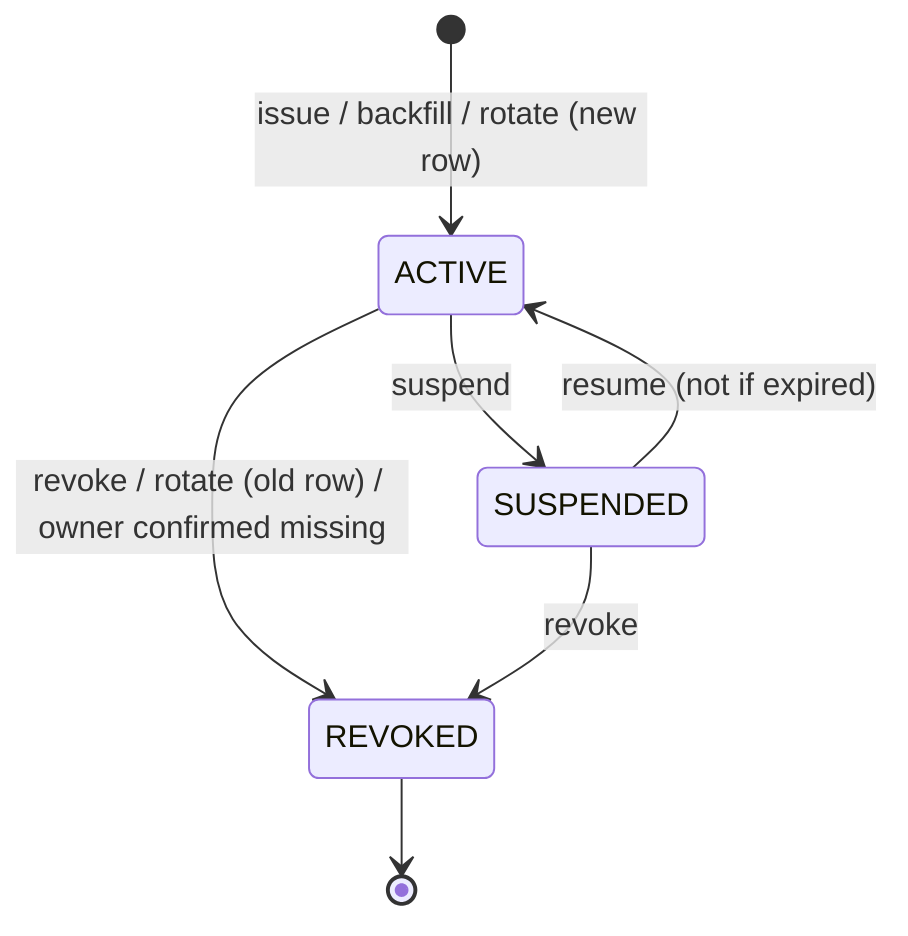
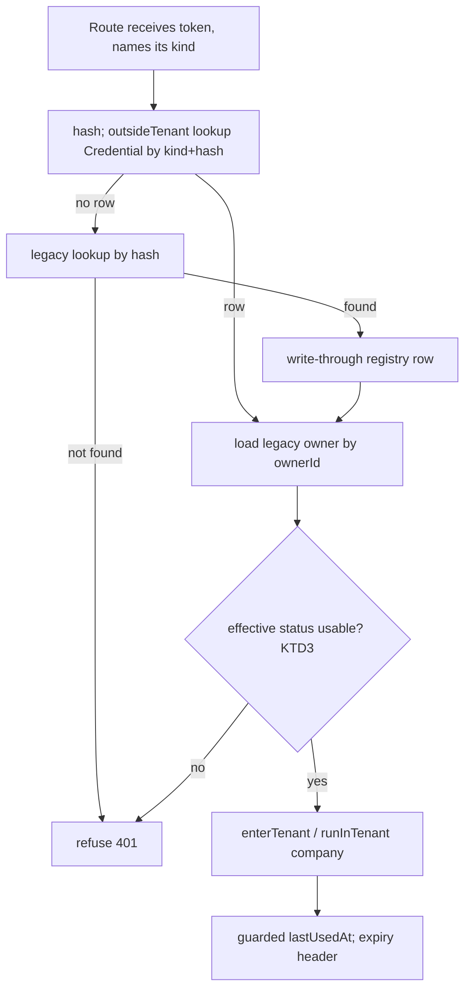
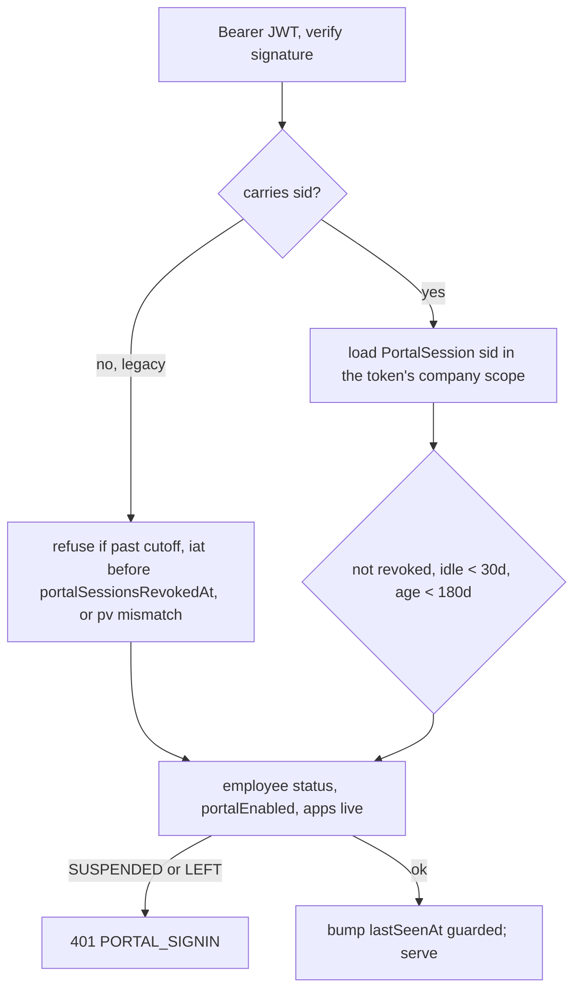
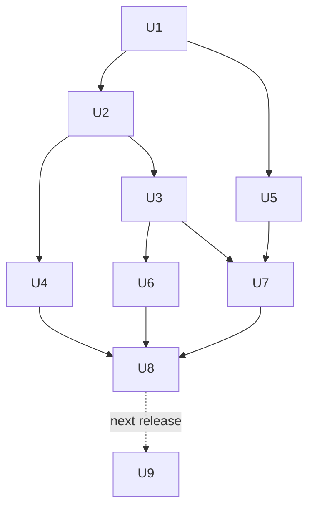

# Machine Credentials Registry (Batch 5, GAP-004) - Plan

## Goal Capsule

- **Objective:** A company admin can see every credential CLOR has issued to a machine or a link for their company, and can pause, rotate, extend or revoke each one. Every such change is on record. A credential that is revoked, expired, suspended, or belongs to a switched-off connector or a closing company stops working on the next request. Employees' portal sign-ins end when HR suspends them or they leave, and can be ended device by device.
- **Means:** one platform credential registry that every token check consults, layered over the existing tables without changing any token already issued (KTD1, KTD2).
- **Authority:** the R-IDs below win on behaviour; the KTDs win on mechanism; `DESIGN.md` wins on any screen; the evidence discipline in `tenant-platform-upgrade-2026-10-23/README.md` (test fails before, passes after, browser check, EV entry) applies to every unit.
- **Stop conditions:** stop and ask before:
  - changing any token string a running integration holds;
  - imposing an expiry on an existing credential;
  - deleting a credential row outright, other than through the closure purge (R19);
  - any production environment or deployment change (those are LIVE items for the owner).
- **Execution profile:** one unit per commit, each with before/after evidence under `tenant-platform-upgrade-2026-10-23/evidence/<A-ID or U-ID>/`; full server and web suites once at the end (U8).
- **Who finishes:** this session implements U1–U8 on branch `claude/subscription-provisioning-gap-003-b84bad`. U9 ships one release later.

---

## Product Contract

### Summary

Add a `Credential` registry and an append-only `CredentialEvent` log to the platform database. Route every machine-token check through one service that consults both the registry and the existing tables. On top of that, fix the four audit findings:
- SCIM tokens gain suspend, expiry and audit, and follow their agent.
- Share links are stored hashed and expire.
- Pay links stop with their invoice.
- Portal sign-ins become revocable, per-device server sessions.

A Credentials page in Company admin lists everything and takes over API key management.

### Problem Frame

Each machine credential type grew its own rules (audit A-31..A-34, GAP-004):
- **SCIM tokens** cannot be paused, never expire, are hard-deleted on revoke, and keep working after their agent is switched off.
- **Invoice share links** sit in the database as readable tokens with no expiry, and anyone with view access mints them.
- **Portal sign-ins** are 30-day JWTs signed with the staff secret. They cannot be ended per device and survive an employee's suspension.
- **No shared record:** nobody can answer "what credentials does this company have, who made them, when were they last used", and there is no single place where a closing or switched-off company's credentials stop.

A-35 already made row-level security fail closed. That is the database backstop, but it does not decide whether a credential should still be honoured.

### Actors

- A1. Company admin (Company admin → Security → Credentials; SSO settings).
- A2. Integration or identity provider holding an API key or SCIM token (Entra, Okta, an ERP).
- A3. On-site agent and attendance readers holding agent or push tokens.
- A4. Customer opening a share or pay link (and the link scanners and chat previewers that fetch it first).
- A5. Employee on the portal (web, Capacitor, native Android).
- A6. HR admin (People / portal administration).
- A7. CLOR itself: expiry job, closure purge, backfill.

### Requirements

**Registry and verification**

- R1. Every SCIM token, API key, site agent token, device push token, pay link and share link has a registry row. Each row records its company, kind, the thing it belongs to, display prefix, status (active, suspended, revoked), optional expiry, creator and last use.
- R2. A token is honoured only when its *effective status* is usable (KTD3). The registry row must allow it, the owning legacy row must still exist and be enabled, its parent (agent) must be usable, its company must not be closing, and the app it serves must be live. One function computes this, and the routes, the UI badges and the expiry job all use it.
- R3. Tokens already issued keep working unchanged: the same string, the same route, and no new expiry. A token found only in a legacy table is registered when first used and by the deploy backfill.
- R4. Every issue, rotate, suspend, resume, extend, revoke, expiry, cascade and review is written to `CredentialEvent`. Each event records who did it (a user, the system, SCIM, an agent or an employee), when, from where, and why. Tokens, refresh secrets and share URLs are never recorded.

**Lifecycle**

- R5. Credential transitions follow the table in KTD5. REVOKED is terminal. Rotating creates a new credential and revokes the old one in the same step; there is no overlap period.
- R6. New API keys and new standalone SCIM tokens default to a one-year expiry, which the admin can change or set to none when creating them. Agent, device and agent-owned SCIM tokens get none unless the admin sets one. Link kinds keep their own expiry rules (R11, R12).
- R7. An admin with edit rights can extend an expiry without rotating. The new expiry may not be later than today plus one year (an absolute cap, not one year added to the current expiry).
- R8. Admins and the creator are warned in the bell 30, 7 and 1 days before an API key or SCIM token expires. Machine JSON APIs return `X-Clor-Credential-Expires` when the token has an expiry.
- R9. When a user is deactivated, removed from a company or deprovisioned by SCIM, the machine credentials they created in that company are flagged "needs review", and the admins get one bell notice. Nothing is revoked automatically. "Mark reviewed" clears the flag and records an event.

**A-31: SCIM and agents**

- R10. SCIM tokens can be suspended, resumed, extended, rotated and revoked. A revoke keeps the row as REVOKED. The five-token cap counts only tokens that are not revoked. Switching an agent off, deleting it or removing its directory sync stops that agent's SCIM token too. Switching the agent back on restores the token, unless an admin suspended it separately. Deleting an agent stores its SCIM token as REVOKED. Rotating an agent leaves its SCIM token as it is. The SCIM token itself can be rotated from Credentials, and the new one is handed to the agent once.

**A-32: links**

- R11. An invoice share link is stored as a hash plus an encrypted copy, so every reminder still sends the same address.
  - **Expiry:** existing links get the later of due date + 90 days and deploy + 90 days. New links get due date + 90 days (invoice date when there is no due date). A reminder extends the link to now + 90 days, capped at two years from the invoice date.
  - **Who can mint:** minting a new link needs `SALES::Invoices::EDIT`. View access can still fetch a live link. A reminder sent without a link says so on screen. Minting and extending are audited.
  - **Invoice lifecycle:** cancelling the invoice suspends the link (stored on the link row too, so an old instance honours it), so its page says the seller cancelled the invoice. Reinstating the invoice resumes the link, and extends it if it expired meanwhile (KTD5). Deleting the invoice revokes it.
- R12. Cancelling an invoice cancels its pending pay requests and revokes their pay links. A paid or claimed pay link still shows its paid or claimed page; it is never turned into a 404.
- R13. Share and pay pages are served with `Referrer-Policy: no-referrer`, noindex and no-store. Opening a link (a GET) never changes state or extends its expiry.

**A-33: portal**

- R14. Each portal sign-in creates a server-side session per device. The response field `token` and the `401 {code:'PORTAL_SIGNIN'}` contract stay the same, so shipped clients keep working.
  - **Lifetime:** a session ends after 30 days without use or 180 days in total.
  - **Cap:** at most 10 sessions per employee; the oldest is ended first.
- R15. Employees see their signed-in devices and can sign out any one of them, or every other one. HR can sign an employee out everywhere. Changing the password ends every other session, including pre-deploy JWTs on other devices.
- R16. When an employee becomes SUSPENDED or LEFT, all their sessions end. Their next request gets `401 PORTAL_SIGNIN`, and sign-in shows "Your app access is paused; please ask HR" (SUSPENDED) or the existing message (LEFT). ON_NOTICE keeps access.
- R17. Portal JWTs issued before deploy keep working until they expire, with these limits:
  - they are subject to the same status checks;
  - they are refused when issued before the employee's last "sign out everywhere", or when their password stamp no longer matches (the existing `pv` check);
  - all of them are refused after a cutoff fixed in code at deploy + 30 days. `PORTAL_LEGACY_JWT_UNTIL` can only bring it earlier, so an unset variable never means no cutoff.
  - No new JWTs are issued.

**Company admin**

- R18. Company admin → Security → Credentials lists every machine credential of the company with its effective status, owner, creator, last use and expiry. From there an admin can:
  - create an API key, shown once;
  - suspend, resume, extend, rotate, revoke, or mark one reviewed.
  - Link kinds appear only as counts.
  - Permission resource `SETTINGS::Credentials` covers it. SCIM rows also need the permission that guards SCIM today (KTD12).
  - Attendance → Integrations' API key section becomes a link to this page.
  - SSO settings still creates SCIM tokens and shows their status, with "Manage in Credentials" for every other action.

**Closure**

- R19. While a company's closure is scheduled, all its credentials and portal sessions are refused without changing their stored status, so cancelling the closure restores them. The purge deletes every Credential, CredentialEvent and PortalSession row of the company.

### Acceptance Examples

- AE1. **Covers R2, R3.** Given an API key revoked in the legacy table by an old instance during a rolling deploy, while its registry row still says ACTIVE, when it calls the public API, then it is refused.
- AE2. **Covers R10.** Given an agent with directory sync, when the admin switches the agent off, then SCIM calls with its token get 401. When the admin switches it back on, SCIM works again. Given an admin who also suspended that SCIM token, switching the agent on leaves it refused.
- AE4. **Covers R11.** Given a share link sent in three reminders, when the invoice is cancelled, then the link shows "cancelled by the seller". When the invoice is reinstated, the same link from the first reminder opens the invoice again.
- AE5. **Covers R11.** Given an invoice 200 days overdue at deploy whose link was sent last month, when the customer opens it the day after deploy, then it opens.
- AE6. **Covers R16, R17.** Given an employee signed in on two phones, one with a pre-deploy JWT, when HR marks them SUSPENDED, then both phones get `401 PORTAL_SIGNIN` on their next request.
- AE7. **Covers R19.** Given a scheduled closure, when the admin cancels it, then API keys, agents, SCIM and portal sessions work again without anyone re-enabling them.

### Key Decisions

- **Default one-year expiry only for API keys and standalone SCIM tokens.** Readers and agents are keyed in once by an installer, so an anniversary expiry would silently stop attendance. Governs R6.
- **Share links stay one address across reminders.** Hash-only storage would break every reminder already sent. Governs R11.
- **Cancel suspends a share link; it does not revoke it.** A reinstated invoice needs its old links back. Governs R11.
- **Credentials belong to the company.** Removing the creator flags them for review; it never revokes. Governs R9.
- **Portal keeps "stay signed in"**, now as a 30-day sliding window plus a 180-day cap, because staff punch from phones. Governs R14.
- **Link kinds are counted, not listed, on Credentials.** Listing them would show invoice customers and amounts to someone without sales access. Governs R18.
- **Rotation is immediate, with no overlap period.** An overlap means two live credentials per owner, each with its own failure modes. Today's rotation is already immediate, and the admin pastes the new token in the same step. Governs R5.

### Scope Boundaries

- Webhook signature timestamps, encryption key ids and AAD, tokens in URL paths, and edge log redaction stay A-34 follow-ups.
- Refresh-token rotation for the portal is not built. Shipped clients have no refresh flow, so it needs a client release. Considered and not built because the per-request session check already gives immediate revocation; revisit with the next Android release.
- A `SECURITY DEFINER` lookup function for tokens is not built (see KTD1). Revisit with A-36.
- A new token format (`clor_<kind>_` with checksum) is not built: every existing token would have to change or be dual-parsed. Revisit when secret-scanning partners are added.
- Rotation grace periods (old token valid for hours or days after rotation) are not built. Revisit if admins report outages when rotating a reader or agent token.
- An emergency "revoke all public links" action is not built. Links expire and follow their invoice; revisit if a mass leak needs a single switch.
- A daily counter of legacy-only verifications is not built. The owner decides when to remove the fallbacks.
- Redacting pay and push URL tokens from server logs (`safeUrl`) stays with the A-34 URL-path follow-up.
- An email copy of expiry warnings is not built. The bell plus the response header cover API keys and SCIM. Revisit if warnings are missed in practice.

#### Deferred to Follow-Up Work

- U9 (dropping the share-link plaintext column) ships one release after U4.
- Portal tokens signed with a separate secret (accept both, sign with the new one) ship one release after U5.
- A boot check that refuses to start in production without a dedicated encryption key (LIVE, with the owner; see Risks).
- The Android app calling the new sign-out endpoint and sending an `X-Clor-Device` label (next native release).
- A sunset date for grandfathered credentials with no expiry, announced in advance.

---

## Planning Contract

### Key Technical Decisions

- KTD1. **Token lookup stays in `outsideTenant`, then `enterTenant`/`runInTenant`.** This is the pattern A-35 set for every token route. A `SECURITY DEFINER` function would add protection only once the runtime role cannot set `clor.bypass` itself (A-36), so it belongs with A-36.
- KTD2. **The registry sits beside the legacy tables, not in place of them.** Legacy rows keep their hashes and enabled flags. The registry is keyed on `(kind, tokenHash)` with the same SHA-256 hex (`hashToken`, moved from `server/src/routes/publicApi.ts` to `server/src/services/credentials.ts`). The kind always comes from the calling route, never from the token prefix: the `clors_` prefix is shared by SCIM tokens and device signing secrets.
- KTD3. **Verify is most-restrictive-wins for as long as legacy tables exist.** Effective status = stored status ∧ not expired ∧ the owner row exists and is enabled ∧ for single-hash owners (ApiClient, SiteAgent, ScimToken, device push) the owner's current hash equals the presented one ∧ the parent owner is usable ∧ the company is not closing ∧ the kind's app is live. The per-kind app policy:
  - SCIM: closing check only;
  - API key, agent and device push: attendance;
  - pay and share links: accounting.

  This one rule covers old instances revoking or rotating in place during a rolling deploy, a failed registry write on rotate, and an owner deleted outright. It does not cover a rollback: old code never reads registry-only state (see Risks).
- KTD4. **Write order across the two databases.**
  - **Revoke, suspend and rotate** write the registry first, and the request fails if that write fails. Rotate revokes the old row and creates the successor before re-hashing legacy.
  - **Mirroring:** revoke and suspend then mirror into legacy where a column has the same meaning: `ApiClient.isActive`, the new `ScimToken.revokedAt/suspendedAt`, `DocumentShareLink.revokedAt` and the new `DocumentShareLink.suspendedAt`, `PaymentRequest.status`. `SiteAgent.isActive` and `AttendanceDevice.isActive` are never written by credential actions: they stay the admin's on/off switches, which KTD3 reads as "owner enabled".
  - **Create** writes legacy first, then the registry. If the registry write fails, verify registers the row when the token is first used (write-through), using an upsert on the `(kind, tokenHash)` unique key.
  - **Owner not found:** verify refuses but never stamps. The daily job (U6) re-reads the owner inside the company's scope and stamps REVOKED `owner_missing` only when it is still absent.
- KTD5. **Transition table.**
  - **Allowed:**
    - ACTIVE → SUSPENDED → ACTIVE;
    - ACTIVE or SUSPENDED → REVOKED.
  - **Rotating:**
    - Rotating issues a successor and revokes the old row in the same step; one live credential per owner.
    - Rotating a suspended or expired credential is allowed; rotating a revoked one returns 409.
    - A unique index on `rotatedFromId` stops a double-click from creating two successors.
  - **Resuming:**
    - Resuming an expired credential returns 409 with "rotate or extend".
    - Resuming while the parent is off or the company is closing is allowed. The stored status changes but the effective status stays blocked, and the UI says why.
  - **Share links:** reinstating an invoice resumes its link, and when the link has expired extends it to now + 90 days within the two-year cap (an `extended` event).
- KTD6. **The agent cascade is computed for switch-off, written for delete.** The parent check resolves through the owner: the agent exists, is switched on, and has a live agent credential. Switching the agent off or on writes nothing to the SCIM token. Deleting the agent stores its SCIM token as REVOKED (`parent_deleted`). Removing directory sync revokes the agent's SCIM token and clears `scimTokenId`. `ensureScimForAgent` treats a revoked token as missing.
- KTD7. **`lastUsedAt` is a guarded update.** It is written only when older than 5 minutes, behind an in-process gate keyed by credential id, fire-and-forget after the response, inside the company's scope. Legacy `lastSeenAt`/`lastUsedAt` writes stay, because readiness and offline alerts read them.
- KTD8. **`CredentialEvent` is append-only in code.** The service exposes no update or delete. It is not enforced by grants or triggers, because the closure purge deletes rows as the app role and would stop. It carries `credentialKind` + `credentialId` with no foreign key, so portal session events fit too. The actor is a nullable user plus `actorType`/`actorLabel`, because `AuditLog.createdByUserId` is required and machine events have no user.
- KTD9. **Share links are stored as hash + `encryptSecret` ciphertext (expand now, contract later).** U4 writes the hash and ciphertext for every link and keeps writing the plaintext column too, because old instances look links up by plaintext and return it to reminders. Lookup is by hash first. U9 stops writing and drops the plaintext one release later. If the copy fails to decrypt, a new link is minted (and an ALERT logged); an empty URL is never returned.
- KTD10. **Portal sessions live in the people database** as `PortalSession`, next to `Employee`, and are purged by `orgId`. Its shape copies the staff `Session` (`server/prisma/platform/schema.prisma` model `Session`, helpers in `server/src/services/auth.ts`).
  - **Token:** the portal keeps issuing a JWT with the same secret, audience and claims, plus a `sid` naming its session row. Old instances still accept it, so a deploy overlap or rollback signs nobody out. New instances require a live session row for any token that carries `sid`.
  - **Legacy tokens** (no `sid`) are measured against `Employee.portalSessionsRevokedAt`, the existing `pv` check and the code-fixed cutoff (R17).
  - **Ending sessions:** `endPortalSessions(employeeId, reason)` is the one hook every status writer and `/password` call; it revokes the rows and moves the epoch.
  - A separate portal signing secret ships in a later release (sign with the new secret, accept both), so this release keeps old instances working.
- KTD11. **The backfill runs at boot under `exclusive('credentials.backfill')`** (`server/src/services/jobLease.ts`). It is idempotent through the unique key, resumable by cursor, and writes one `migrated` event per row. It links agent SCIM tokens to their agent before the cascade relies on them. The code is correct before the backfill finishes, because of write-through.
- KTD12. **Permissions.**
  - `SETTINGS::Credentials` maps view to list, create to create, edit to suspend, resume, extend, rotate, revoke and review. Delete is not used by these routes.
  - A permission-seed migration grants view, create and edit to every role that holds Attendance Integrations create or edit today, so nobody loses API key management, including revoke, at deploy.
  - SCIM rows are listed only to holders of `SETTINGS::Users::VIEW`, and every SCIM action also needs `SETTINGS::Users::EDIT`, the permission that guards SCIM today. A credentials permission alone never controls user provisioning.
  - Old `integrations.ts` key routes stay for older bundles and go through the same service.

### Alternatives Considered

- **Status columns on each legacy table, with no registry.** One source of truth per credential and no cross-database write order. Rejected because the confirmed scope is one registry. The Credentials page and closure would need a union across three databases. Every new credential kind would repeat the status, expiry and event plumbing.

### High-Level Technical Design

Credential lifecycle (stored status). Effective status adds the computed blocks from KTD3.

Verify path for a machine token.

Portal request path.

### Assumptions

- Production runs two Cloud Run instances, and each one runs `prisma:deploy` on boot (`server/scripts/cloudrun-start.sh`), so old and new code overlap during a deploy. KTD3, KTD9 and KTD10 are sized for that.
- The four schemas can be four separate databases, so no change relies on a cross-schema transaction or foreign key.
- No shipped client calls a portal refresh endpoint. Android stores a new `token` only from `/login`, `/activate` and `/password`.

### Sequencing

U1 first, then U2, then U3, U4 and U5 in any order (they touch separate routes). U6 depends on U1–U3. U7 depends on U1, U3 and U5 for data. U8 closes the batch. U9 is next release.

### Risks & Dependencies

| Risk | Mitigation |
|---|---|
| Encryption key falls back to `JWT_SECRET`; rotating it breaks reminder links | KTD9 re-mints on decrypt failure; owner sets `MAIL_SECRET_KEY` in production (LIVE item, recorded in FIX_CHECKLIST) |
| Entra quarantines a SCIM app after repeated 401s; resuming in CLOR does not lift it | Suspend confirmation text says so; expiry warnings (R8) |
| Android background calls keep idle sessions alive; a lost phone stays signed in up to 180 days | Accepted; HR "sign out everywhere" and device list cover it; noted in HR copy |
| Registry write volume from chatty readers | KTD7 gate |
| Permission move strands key managers | KTD12 seed grant, tested |
| Rollback to pre-Batch-5 code honours suspended SCIM tokens and cancelled invoices' share links again until roll-forward (old code never reads the new columns) | Accepted for the rollback window; revoke (not suspend) for a leaked credential, since revoke mirrors into columns old code reads |
| Concurrent full suites on the shared test database (people-build session) cause flaky failures | Re-run failing files alone, as in Batches 3–4 |

### Sources & Research

- Code map: `server/src/routes/{scim,security,integrations,agent,publicApi,ingest,hikvisionPush,matrix,devices,payRequests,share,portal,portalAdmin,users,invoices}.ts`, `server/src/services/{principalAllowed,companyClosure,auditTrail,auth,mailer,jobLease,notifications}.ts`, `server/src/utils/{tenantScope,safeUrl}.ts`.
- Stripe key rotation, with the old key kept up to 7 days; GCP disable-before-delete; Atlassian's one-year default and later sunset; Entra/Okta static SCIM tokens (KTD5, R6, R8). Sources: docs.stripe.com/keys, docs.cloud.google.com/iam/docs/keys-disable-enable, support.atlassian.com manage-api-tokens.
- RFC 9700 §2.2.2/§4.14.2 and the OWASP Session Management cheat sheet (KTD10, the refresh-token non-goal).
- W3C TAG Capability URLs; Stripe hosted invoice link expiry (R11, R13).
- OWASP Logging cheat sheet: never log tokens (R4).
- GitLab's guarded `last_used_at` update (KTD7).

---

## Implementation Units

### U1. Registry core

- **Goal:** `Credential` and `CredentialEvent` exist with fail-closed RLS. One service issues, transitions, verifies and records credentials.
- **Requirements:** R1, R2, R4, R5, R7, R19.
- **Dependencies:** none.
- **Files:**
  - `server/prisma/platform/schema.prisma`
  - `server/prisma/platform/migrations/20261024120000_credentials/migration.sql`
  - `server/prisma/platform/migrations/20261024120100_credentials_rls/migration.sql`
  - `server/src/__tests__/globalSetup.ts`
  - `server/src/services/credentials.ts` (new)
  - `server/src/routes/publicApi.ts` (re-export `hashToken`)
  - `server/src/services/companyClosure.ts`
  - `server/src/__tests__/credentialRegistry.test.ts` (new)
- **Approach:**
  1. **Columns.** Kind, owner kind and owner id, parent owner id, `tokenHash` (unique with kind), prefix, status, `expiresAt`, `rotatedFromId` (unique), `revokedReason`, `createdByUserId`, `needsReviewReason`, last used and IP.
  2. **Events.** Fields per KTD8 and R4. The policy SQL is written in the fail-closed shape directly and added to the `globalSetup.ts` list.
  3. **Service.** `effectiveStatus` (KTD3), `verifyCredential(kind, token, ownerLoader)`, `issue`, `rotate`, `suspend`, `resume`, `extend`, `revoke`, `markReviewed`, `recordCredentialEvent`, and `touchLastUsed` (KTD7). Transitions follow KTD5.
  4. **Purge.** The closure purge already deletes by `orgId`; confirm both models are included.
- **Patterns to follow:** `server/prisma/platform/migrations/20261018040100_scim_tokens_rls` for structure, `20261024100000_rls_fail_closed` for the policy body; `server/src/services/auditTrail.ts` for never-throwing event writes.
- **Test scenarios:**
  - Issue then verify returns the company and kind. A wrong kind with the right hash is refused.
  - Suspend then verify is refused; resume then verify is accepted.
  - Revoke, then resume and rotate both return 409.
  - Expired is refused. Resuming an expired credential returns 409. Extend by 6 months is accepted; extend by 2 years is refused.
  - Rotate: the new token verifies and the old one is refused at once, with one `rotated` event on each row.
  - Rotate a suspended credential: allowed; the successor is ACTIVE.
  - Two concurrent rotates leave exactly one successor.
  - The owner loader returns a disabled owner: refused even though the registry says ACTIVE (AE1).
  - The owner's current hash differs from the presented token (rotated in place by old code): refused.
  - The owner loader returns null: refused, and the registry status is unchanged.
  - Company closing: refused; closure cancelled: accepted (AE7).
  - Each transition writes one event with actor and reason. No event body contains the token or its hash.
  - RLS: `pg_class` shows ENABLE + FORCE on both tables. With no company set inside a request, both tables read empty.
  - Closure purge removes both tables' rows for the company only.
- **Verification:** new test file passes; it fails at HEAD (missing module) — evidence `before-fix.txt` records the failure mode; `rlsFailClosed.test.ts` still passes.

### U2. Cut API keys, agents and device push over to the registry

- **Goal:** These routes authenticate through `verifyCredential` and dual-write every change. Existing tokens keep working, and the backfill registers them.
- **Requirements:** R1, R2, R3, R5, R6.
- **Dependencies:** U1.
- **Files:**
  - Routes: `server/src/routes/publicApi.ts`, `server/src/routes/agent.ts`, `server/src/routes/ingest.ts`, `server/src/routes/hikvisionPush.ts`, `server/src/routes/matrix.ts`, `server/src/routes/integrations.ts`, `server/src/routes/devices.ts`
  - Backfill: `server/src/services/credentialBackfill.ts` (new), `server/src/index.ts`
  - Tests: `server/src/__tests__/credentialMatrix.test.ts` (new), `server/src/__tests__/integrations.test.ts`, `server/src/__tests__/agent.test.ts`
- **Approach:**
  1. **Verify call.** Each auth block becomes a `verifyCredential` call that names its kind. The `appLive` checks fold into KTD3's per-kind policy.
  2. **Changes.** Create, rotate, revoke and switch-off follow the KTD4 order.
  3. **API keys.** Rotating a revoked key returns 409, where today it silently re-activates (C5). Rotation goes registry-first (KTD4), and verify loads the owner by `ownerId`, then compares its current hash (KTD3).
  4. **Backfill.** Runs per KTD11.
- **Execution note:** Start with the cross-kind matrix test, so the first failing run documents today's gaps.
- **Patterns to follow:** `server/src/__tests__/principalAllowed.test.ts` helpers (`apiKey`, `lapse`, closure row) for the matrix.
- **Test scenarios:**
  - For each of API key, agent, HTTP push, Matrix and Hikvision: issued → works; suspended → 401/403; revoked → refused; legacy disabled while the registry is ACTIVE → refused; company closing → refused; app off → refused; another company's token on this company's device id → refused.
  - A legacy-only token (registry row deleted) works once and leaves a registry row with a `migrated` or write-through event.
  - Running the backfill twice concurrently leaves the same row count.
  - Rotating a revoked API key returns 409.
  - Rotating an API key: the new key works and the old one is refused at once.
  - An old instance rotates a key in place (legacy re-hash only, registry untouched): the old token is refused.
  - The registry write fails during rotate: the request fails and the old key still works.
  - Switching an agent on leaves a separately suspended agent credential refused; switching it off refuses its token and its SCIM token.
  - `lastUsedAt` is written once for 10 calls inside 5 minutes.
- **Verification:** matrix fails before (suspend/expiry/legacy-mismatch rows) and passes after; existing `ingest`, `matrix`, `hikvisionAnviz`, `agent`, `integrations`, `tenantBackstop`, `punchRouting` tests pass.

### U3. SCIM lifecycle and agent cascade (A-31)

- **Goal:** SCIM tokens gain the full lifecycle, and an agent's state governs its SCIM token.
- **Requirements:** R5, R6, R7, R10.
- **Dependencies:** U2.
- **Files:**
  - Schema and migration: `server/prisma/platform/schema.prisma` (`ScimToken.revokedAt`, `suspendedAt`), `server/prisma/platform/migrations/20261024120200_scim_token_status/migration.sql`
  - Routes: `server/src/routes/scim.ts`, `server/src/routes/security.ts`, `server/src/routes/agent.ts`, `server/src/routes/integrations.ts`
  - Tests: `server/src/__tests__/scimLifecycle.test.ts` (new), `server/src/__tests__/scim.test.ts`
- **Approach:**
  1. **Routes.** The SCIM middleware uses verify. The security routes gain suspend, resume, extend and rotate, and DELETE becomes a soft revoke.
  2. **Cap.** It counts only tokens that are not revoked.
  3. **Agent token.** Revoking an agent's SCIM token from Credentials or SSO clears `scimTokenId`, so the next directory-sync save issues a new one.
  4. **Agent fixes.** Per KTD6: the `ldap: null` revoke, `ensureScimForAgent` skipping revoked rows, and the delete cascade. The `.catch(() => {})` on agent SCIM rotation is removed.
  5. **Permissions.** Every SCIM action keeps requiring `SETTINGS::Users::EDIT` (KTD12).
- **Test scenarios:**
  - Suspend: SCIM 401. Resume: SCIM 200.
  - DELETE keeps the row as REVOKED, with an event; the revoked token gets 401.
  - Five revoked tokens do not block creating a sixth.
  - New standalone token has `expiresAt` ≈ now + 1 year; an agent-owned token has none.
  - Covers AE2: agent off → SCIM 401; agent on → 200; agent on with the token separately suspended → still 401.
  - Agent deleted → SCIM 401, and the row stays REVOKED.
  - `ldap: null` → SCIM 401. Adding LDAP again hands a new token to the agent.
  - Rotating the agent's SCIM token from Credentials hands the new one to the agent once through `pendingEnc`; the old one gets 401.
- **Verification:** `scimLifecycle.test.ts` fails before on suspend, soft revoke, cascade and handover, and passes after; `scim.test.ts` and `security.test.ts` pass.

### U4. Share links and pay links (A-32)

- **Goal:** Share links are hashed with an encrypted copy, expire, and follow the invoice. Pay links stop with a cancelled invoice. Link pages leak nothing.
- **Requirements:** R11, R12, R13 (and R1–R2 for the link kinds).
- **Dependencies:** U2.
- **Files:**
  - Schema and migration: `server/prisma/schema.prisma` (`DocumentShareLink.tokenHash` unique, `tokenEnc`, `suspendedAt`), `server/prisma/migrations/20261024120300_share_link_hash/migration.sql`
  - Server: `server/src/routes/share.ts`, `server/src/routes/payRequests.ts`, `server/src/routes/invoices.ts`
  - Web: `apps/accounting/src/features/sales/PaymentReminders.jsx`, `apps/accounting/src/features/sales/SharedInvoice.jsx`, `public/_headers`, `docker/nginx.conf`, `deploy/Caddyfile`, `deploy/Caddyfile.production`
  - Tests: `server/src/__tests__/share.test.ts`, `server/src/__tests__/payRequests.test.ts`, `server/src/__tests__/shareLinkHashed.test.ts` (new)
- **Approach:**
  1. **Backfill.** Hash and encrypt existing plaintext, and set the R11 expiry formula, in the U2 backfill.
  2. **Mint.** Creating a link needs `SALES::Invoices::EDIT`; fetching an existing link stays VIEW.
  3. **Invoice lifecycle.** In `invoices.ts`, cancel suspends the share link and cancels pending pay requests, reinstate resumes the link, and delete revokes it.
  4. **Page headers.** For the SPA share page: meta referrer and robots in `SharedInvoice.jsx`, plus `_headers`/proxy rules for `?share=`. Pay pages gain `Referrer-Policy`.
- **Test scenarios:**
  - Three reminder fetches return the same URL; every row has a hash and ciphertext, and plaintext is still written until U9.
  - A VIEW-only user fetches a live link (200) but cannot mint when there is none (403). The reminder UI shows the "sent without a link" notice (web test).
  - Covers AE5: a backfilled link on a 200-day-overdue invoice opens.
  - A new link with a due date has expiry = due + 90d. A reminder fetch extends it to now + 90d, never past invoice date + 2y. A public GET does not extend it.
  - Covers AE4: cancel → public GET returns the cancelled page (not a generic 404), and `suspendedAt` is set; reinstate → the same token opens.
  - Reinstating an invoice whose link expired while cancelled extends the link and records an `extended` event.
  - Invoice delete → 404.
  - Ciphertext unreadable (key changed) → the reminder fetch mints a new link and logs ALERT.
  - Cancelling an invoice → its PENDING pay request is CANCELLED, and `/claim` is refused. A PAID request still renders "Paid".
- **Verification:** `shareLinkHashed.test.ts` fails before (no hash, VIEW mints, no expiry, cancel leaves the pay link payable) and passes after; browser check that a reminder link opens, and that a cancelled invoice's link shows the cancelled page.

### U5. Portal sessions (A-33)

- **Goal:** Portal sign-ins are per-device server sessions that HR suspension, sign-out and password change end at once. Shipped clients keep working.
- **Requirements:** R14, R15, R16, R17, R19.
- **Dependencies:** U1 (events).
- **Files:**
  - Schema and migrations: `server/prisma/people/schema.prisma` (`PortalSession`, `Employee.portalSessionsRevokedAt`), `server/prisma/people/migrations/20261024120400_portal_sessions/migration.sql`, `server/prisma/people/migrations/20261024120500_portal_sessions_rls/migration.sql`, `server/src/__tests__/globalSetup.ts`
  - Server: `server/src/services/portalSessions.ts` (new), `server/src/routes/portal.ts`, `server/src/routes/portalAdmin.ts`, `server/src/routes/people.ts`, `server/src/routes/personnel.ts`, `server/src/routes/publicApi.ts`
  - Web: `apps/attendance/src/portal/portalApi.js`, `apps/attendance/src/screens/PortalAccess.jsx`
  - Tests: `server/src/__tests__/portalSessions.test.ts` (new), `server/src/__tests__/portal.test.ts`, `tenant-platform-upgrade-2026-10-23/route-allowlist.json`
- **Approach:**
  1. **Sign-in.** `/login`, `/activate` and `/password` create a session and return a JWT carrying its `sid` as `token` (KTD10).
  2. **Every request.** `authenticate` follows the portal flow in the High-Level Technical Design.
  3. **New endpoints.** Sign-out, list sessions, end one, and end the others (allow-listed). HR "sign out everywhere" goes in `portalAdmin.ts`, with a per-person "Sign out everywhere" button beside "Forget password" on `PortalAccess.jsx`. Its confirmation says the person can sign in again with their password (unlike Forget password) and notes that a lost phone otherwise stays signed in up to 180 days.
  4. **Status writers.** `people.ts`, `personnel.ts`, `publicApi.ts`, `portalAdmin.ts` and payroll settlement call `endPortalSessions` on a move to SUSPENDED or LEFT.
  5. **Sign-in refusals.** `findEmployee` refuses SUSPENDED with the R16 text.
  6. **Web client.** The web portal calls the sign-out endpoint.
- **Test scenarios:**
  - Sign-in returns a `token` whose claims carry `sid`. `/me` works, and the session lists with a device label from the user agent ("CLOR app" when it is not a recognisable browser).
  - A `sid` token whose session row is revoked gets `401 PORTAL_SIGNIN`, even though its signature and `pv` are valid.
  - Covers AE6: with one session token and one pre-deploy JWT (no `sid`), HR sets SUSPENDED → both get `401 PORTAL_SIGNIN`.
  - ON_NOTICE keeps access.
  - A status change through `publicApi` PATCH `/employees/:code` ends sessions.
  - HR "sign out everywhere" ends a legacy JWT (iat before the epoch).
  - Legacy JWT after `PORTAL_LEGACY_JWT_UNTIL` → 401. With the variable unset and the clock past the code-fixed cutoff → 401.
  - `/password` on one device: a pre-deploy JWT on another device gets 401.
  - Idle 31 days (frozen clock) → 401. 181 days with daily use → 401.
  - Eleventh sign-in ends the oldest.
  - `/password` keeps the current session and ends the others.
  - Sign-out ends only this session.
  - A suspended employee's sign-in shows "Your app access is paused; please ask HR".
  - Closure scheduled → refused; cancelled → the same session works.
- **Verification:** new test fails before (no sessions, SUSPENDED not refused) and passes after; existing `portal.test.ts` passes, with only changes forced by the new `sid` claim (recorded in evidence); browser check of web portal sign-in, sign-out and device list.

### U6. Expiry warnings, extension and review flags (A-34 parts)

- **Goal:** Admins learn about an expiry before it happens and can extend it. Removing a creator flags their credentials for review. Credentials whose owner is confirmed gone are retired.
- **Requirements:** R7, R8, R9, KTD4 (owner missing).
- **Dependencies:** U1, U3.
- **Files:**
  - Job: `server/src/services/credentialExpiry.ts` (new), `server/src/index.ts`
  - Review-flag hooks: `server/src/routes/users.ts`, `server/src/routes/scim.ts`
  - Header: `server/src/services/credentials.ts`
  - Test: `server/src/__tests__/credentialExpiry.test.ts` (new)
- **Approach:**
  1. **Job.** A daily leased job selects API keys and SCIM tokens with `expiresAt - now <= N` days that have no `expiry_warning_sent{N}` event. It notifies admins, `SETTINGS::Credentials` editors and the creator, then writes the event.
  2. **Skips.** Closing companies, rows with a successor, and link kinds are skipped.
  3. **Owner missing.** The job re-reads each owner the verify path could not find, inside the company's scope, and stamps REVOKED `owner_missing` only when it is still absent.
  4. **Review flags.** User removal hooks flag that company's machine credentials and send one bell notice; SCIM deprovision records `actorType=scim`.
  5. **Expiry header.** Added by the verify helper for SCIM, the public API and the agent.
- **Test scenarios:**
  - A key expiring in 29 days → one 30-day notice. Running the job twice → still one.
  - Skipping a day still yields the 7-day notice when crossing it.
  - A revoked or rotated-away row never gets a warning.
  - Owner deleted → the job stamps REVOKED `owner_missing`; an owner present when read in its company scope is left alone.
  - Removing a user from a company flags only that company's credentials and sends one notice. Mark reviewed clears the flag and writes an event. Re-adding the user does not clear the flag.
  - Public API responses carry `X-Clor-Credential-Expires` for a key with expiry and omit it otherwise.
- **Verification:** new test fails before and passes after; `notifications` and `users` tests pass.

### U7. Company admin Credentials page and surrounding UI

- **Goal:** One page lists and manages the company's machine credentials, API key management lives there, and other screens show effective status.
- **Requirements:** R18, R15 (device list UI), R11 (reminder notice), KTD12.
- **Dependencies:** U1, U3, U5.
- **Files:**
  - Server: `server/src/routes/credentials.ts` (new), `server/src/app.ts`, `server/src/constants/permissionCatalog.ts`, `server/src/services/permissionCatalogSeed.ts`, `server/prisma/platform/migrations/20261024120600_credentials_permission_grant/migration.sql`, `server/src/routes/audit.ts`
  - Company admin: `apps/admin/manifest.jsx`, `apps/admin/src/screens.jsx`, `apps/admin/src/screens/Credentials.jsx` (new), `packages/platform/admin/credentials.js` (new), `apps/admin/src/screens/SsoSettings.jsx`
  - Attendance: `apps/attendance/src/screens/Integrations.jsx`, `apps/attendance/src/portal/EmployeePortal.jsx` (device list)
  - Tests: `server/src/__tests__/credentialsRoute.test.ts` (new), `apps/admin/src/screens/Credentials.test.jsx` (new)
- **Approach:**
  1. **Page layout.** A list on the page ground under one hairline, with no card-in-card. The primary action, Create API key, sits top right. It is disabled with a reason when Attendance is off.
  2. **Rows and filters.**
     - Pills: Active (`pos`); Suspended, Revoked, Expired (neutral); Blocked (warn), with a sub-line naming the KTD3 reason, e.g. "Blocked: Attendance is off". Needs review is a second pill with its reason as a caption.
     - When the company is closing, one page banner ("Closure scheduled; all credentials are paused") replaces the per-row reason.
     - The default filter shows Active, Suspended and Expired; "Show revoked" adds the rest. Sort: needs review first, then soonest expiry. The table scrolls in its own `.ui-table-scroll`. Loading, empty ("No credentials yet" plus Create) and load-failed states follow `Integrations.jsx`.
     - A summary row shows link counts only.
  3. **Actions by effective status.**
     - Active: Suspend, Extend, Rotate, Revoke.
     - Suspended: Resume, Rotate, Revoke.
     - Expired: Extend, Rotate, Revoke.
     - Revoked: none.
     - Mark reviewed appears only when flagged. Actions sit in a row menu at narrow widths. A view-only user sees no Create button and no row actions.
  4. **Dialogs.**
     - Suspend, revoke and rotate ask for a reason (select plus optional note), recorded per R4. The suspend confirmation for SCIM names the Entra quarantine consequence.
     - Extend offers +3 months, +6 months and +1 year, capped per R7.
     - Create API key carries over name, scopes and allowed addresses from `Integrations.jsx`, plus an expiry select defaulting to one year with a "No expiry" option.
  5. **Token reveal.** Reuse `ShownOnce` (move it to `packages/ui`).
  6. **Audit.** Add `Credential` to the COMPANY audit bucket.
  7. **Elsewhere.**
     - Attendance's key section becomes a short link.
     - The SSO list shows each token's status and blocked reason, with "Manage in Credentials".
     - The portal's profile tab gains "Signed-in devices". Each row shows the label, "Signed in {date}" and "Last used {ago}". The current device carries a "This device" pill and no row button, because Sign out covers it. Other rows have "Sign out". "Sign out all other devices" asks for confirmation first. With a single device the section says "This is the only device signed in."
     - Loading and error states are included.
  8. **Design.** Tokens only; 8px radii on controls and 12px on content; status shown as pill plus text, never colour alone.
- **Test scenarios:**
  - A user with only `SETTINGS::Credentials::VIEW` lists credentials but gets 403 on create.
  - A role that had Attendance Integrations EDIT before the migration can create and revoke a key after it.
  - That same role does not see SCIM rows and gets 403 when it tries to rotate or suspend a SCIM token.
  - The list never includes token, hash or share URL fields.
  - Link kinds appear only as counts, and only to users who also hold `SALES::Invoices::VIEW`.
  - Web: the page renders effective statuses, and shows the token once after create.
  - Web: the suspend confirmation names the consequence for SCIM (Entra quarantine).
  - The portal device list marks "This device", and "Sign out all other devices" ends the others but not this one.
  - Web: an Active row offers Suspend, Extend, Rotate and Revoke; a Revoked row offers none.
- **Verification:** tests pass; browser check of each action on the dev app (as `clor_app`) with screenshots in light and dark mode and at phone width; `DESIGN.md` audit noted in `browser-check.md`.

### U8. Close the batch

- **Goal:** The route manifest, docs, checklist, evidence and full suites all reflect Batch 5.
- **Requirements:** all.
- **Dependencies:** U4, U6, U7.
- **Files:**
  - Allow-list and checklists: `tenant-platform-upgrade-2026-10-23/route-allowlist.json`, `tenant-platform-upgrade-2026-10-23/FIX_CHECKLIST.md` (Batch 5 row split into A-31, A-32, A-33, A-34-parts and the registry; drop `Principal`), `tenant-platform-upgrade-2026-10-23/EVIDENCE_REGISTER.md`, `tenant-platform-upgrade-2026-10-23/CHANGE_LOG.md`, `tenant-platform-upgrade-2026-10-23/THREAT_AND_GAP_REGISTER.md`
  - Docs: `tenant-platform-upgrade-2026-10-23/DECISION_LOG.md`, `docs/compliance/DATA_DELETION_AND_CLOSURE.md`
- **Approach:** Batch 5 reasons in the allow-list are updated to name the registry. Full server and web suites are recorded as one EV, with web compared against the baseline.
- **Test expectation:** none -- documentation and gate bookkeeping; `routeManifest.test.ts` is the check.
- **Verification:** route gate passes; full suites green apart from baseline and load-flaky files re-run alone.

### U9. Drop share-link plaintext (next release)

- **Goal:** No share-link token remains readable at rest.
- **Requirements:** R11.
- **Dependencies:** U4 deployed for one release; the backfill has reached every row.
- **Files:**
  - `server/prisma/schema.prisma`
  - `server/prisma/migrations/<next>_share_link_drop_plaintext/migration.sql`
  - `server/src/routes/share.ts`
  - `server/src/__tests__/shareLinkHashed.test.ts`
- **Approach:** null the column, then drop it and the plaintext fallback.
- **Test scenarios:**
  - A database scan finds no non-null plaintext.
  - Lookup by plaintext is gone; the hash still works.
- **Verification:** test passes; A-32 marked fully DONE.

---

## Verification Contract

| Gate | Command | When |
|---|---|---|
| Unit's own test before/after | `cd server && npx vitest run src/__tests__/<file>` with the changed files swapped to HEAD for the before run | every unit |
| Server types | `npm run typecheck` | every server unit |
| Web tests for touched screens | `npx vitest run <path>` | U4, U5, U7 |
| Route manifest gate | `cd server && npx vitest run src/__tests__/routeManifest.test.ts` | U5, U7, U8 |
| RLS gate | `cd server && npx vitest run src/__tests__/rlsFailClosed.test.ts src/__tests__/rowLevelSecurity.test.ts` | U1, U5 |
| Full suites | `npm --prefix server test` and `npm run test:web` (background, ~15 min), web compared with `evidence/W-01..04/web-baseline-failures-main-checkout.txt` | U8 |
| Browser | dev API as `clor_app` (launch config `clor-api-app-role`) + web on 5173 | U4, U5, U7 |

## Definition of Done

- Every code unit (U1–U7, U9) has a test that fails at HEAD and passes after, saved as `before-fix.txt` / `after-fix.txt`, and an EV entry (EV-058 onward).
- FIX_CHECKLIST shows A-31, A-32 (U9 pending), A-33, the A-34 parts and the registry as DONE. Production-only items are listed as LIVE: the encryption key, removing the legacy fallbacks when the owner chooses, and the legacy JWT cutoff passing.
- No token, hash or share URL appears in any event, log line or API list response.
- No dead code from abandoned approaches remains in the diff.
- `DESIGN.md` rules hold on every new or changed screen.
